# Evolution X 16 for the REDMAGIC 10 Pro / 10S Pro (NX789J)

Unofficial [Evolution X](https://evolution-x.org) 16 (Android 16) build for the nubia
REDMAGIC 10 Pro and 10S Pro (model **NX789J**), with Google apps, a KernelSU-Next + SUSFS
kernel and **RedMagic Tools** for the hardware extras (cooling fan, side slider, performance
modes, charge separation).

  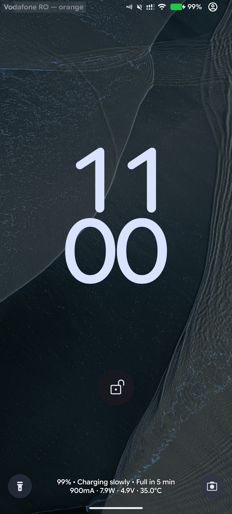
  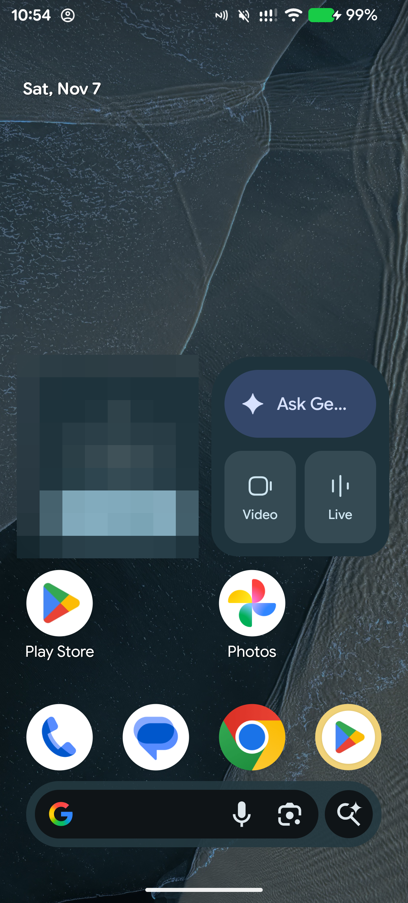
  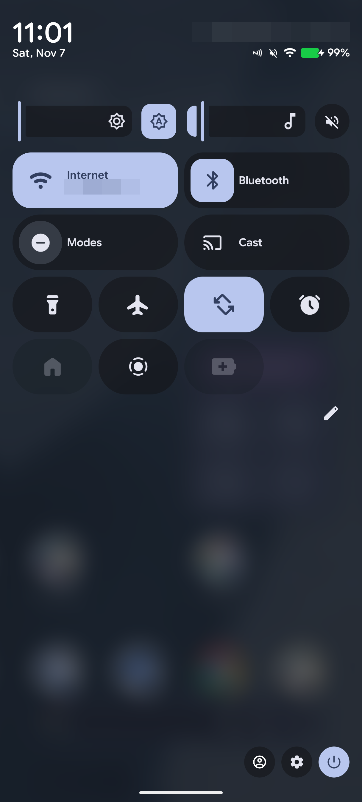
  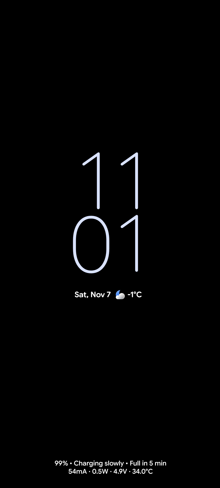

  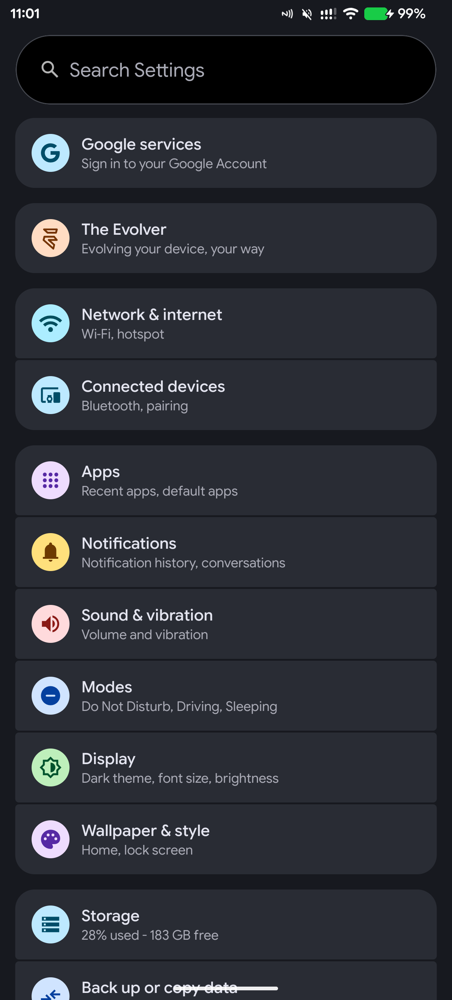
  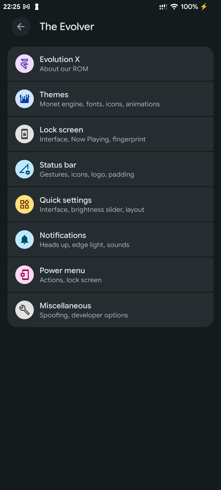
  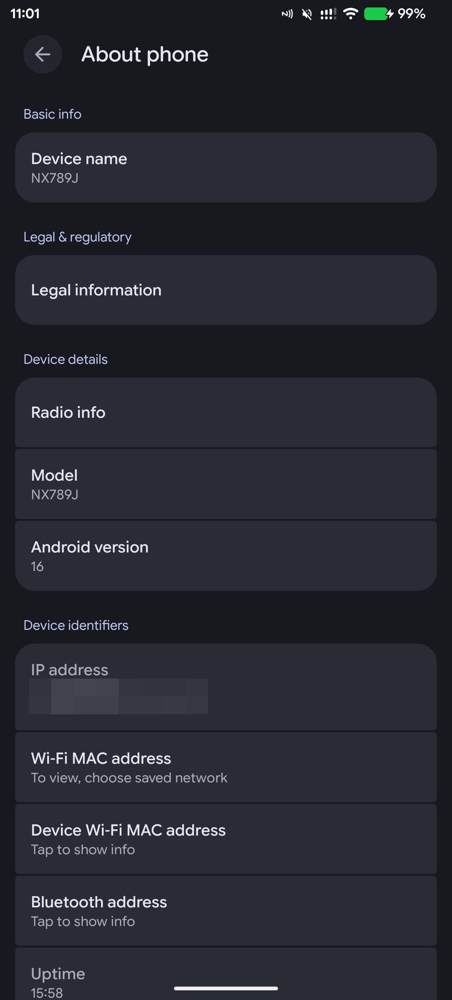
  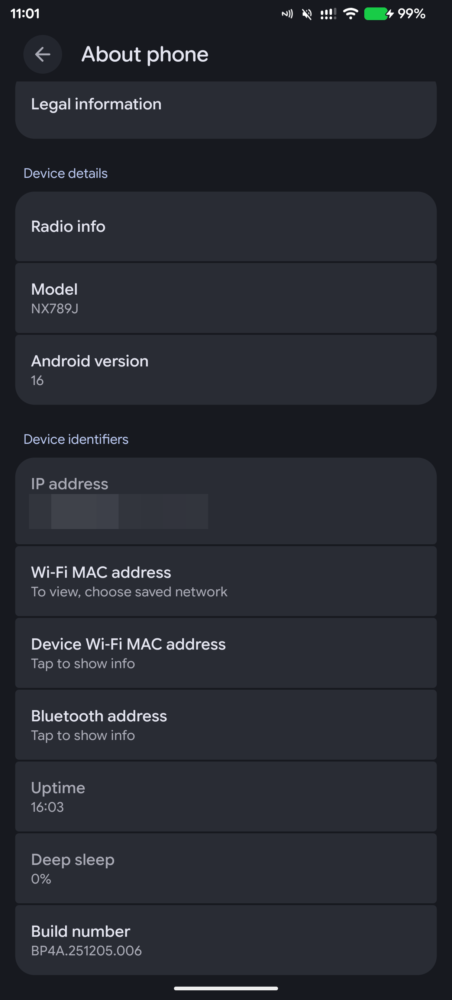

  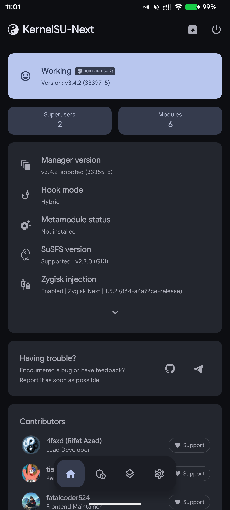
  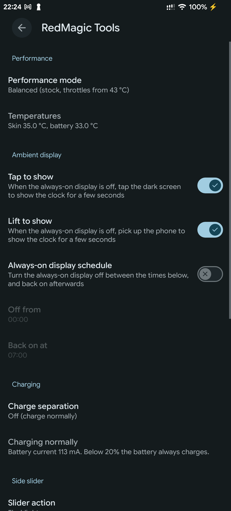
  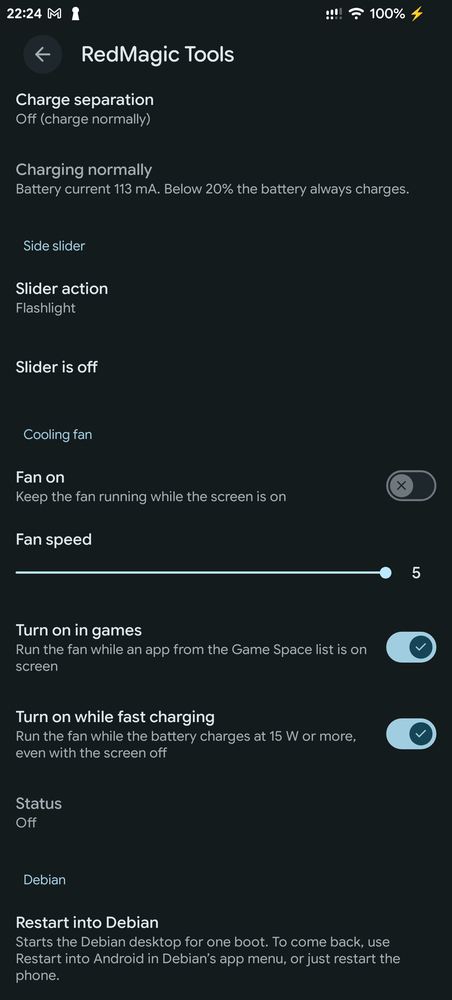

> [!IMPORTANT]
> Needs an **unlocked bootloader**. Unofficial: not made or supported by the Evolution X team,
> nubia or ZTE. You install it at your own risk.

**Download:** [Releases](../../releases) (latest: **16.0-20261106.2**).

## What works

| | |
|---|---|
| Display | 144 Hz, touch, always-on display |
| Fingerprint | Under-display sensor, also from the always-on display |
| Calls and data | Calls, VoLTE, SMS, mobile data, both SIMs |
| Audio | Speakers with DTS sound (switches itself off on Bluetooth so earbuds sound right), call audio, louder media volume curve |
| Wi-Fi, Bluetooth, NFC | Wi-Fi, Bluetooth audio (classic and LE audio), NFC |
| Cameras | All rear cameras (main, ultra-wide, macro) through the stock RedMagic camera app |
| RedMagic hardware | Cooling fan (manual, in games, while fast charging), side slider (flashlight and more), performance modes, temperatures |
| Root | KernelSU-Next with SUSFS built into the kernel (install the KernelSU Next manager app) |
| Play Integrity and Wallet | Strong integrity and Google Wallet tap-to-pay work with your own keybox and the usual modules (no keybox is included) |
| Debian | **Restart into Debian** in RedMagic Tools, when [Debian](https://github.com/devnotcc/nx789j-installer) is installed |

## What doesn't (yet)

- **Not ported yet:** the shoulder triggers and the RGB lighting.
- **Bluetooth call audio is sometimes silent**, seen with one earbud in and music playing when
  the call comes in. Being looked into.
- The **Restart into Debian** description still says a plain restart brings you back to Android;
  since Debian 13-20261107 a plain restart stays in Debian (use **Restart into Android** in
  Debian's app menu).

Found something else? [Open an issue](../../issues) with what you did and, if you can, a
`adb logcat` from when it happened.

## Install

You need an **unlocked bootloader** first. The free unlock for the 10 Pro is the
**ZTE Family Toolbox** (中兴家族工具箱) **1.2.8-beta4**, from
[this XDA thread](https://xdaforums.com/t/red-magic-11-pro-guide-bootloader-unlock-free-also-support-rm10-pad3pro-z70u-z80u-unlock-zte-family-toolbox.4780930/).
Don't update the stock firmware to 11.0.13 or later before unlocking: the thread reports that
it blocks the unlock.

Tested on stock firmware **RedMagicOS 11.0.4** (baseband `...1.82720.133`). Firmware isn't
replaced by this ROM. **RedMagicOS 11.0.5** (baseband `...1.82720.138`) is allowed as
experimental: the phone keeps its newer modem firmware with this ROM's 11.0.4 radio libraries,
so calls, mobile data or SIM detection might not work. Make a full backup first (installer: Tools →
Back up every partition) and please report how it goes. Other versions aren't tested.

### Recommended: the installer app

The [NX789J Installer](https://github.com/devnotcc/nx789j-installer) does everything: it checks
the phone and the bootloader unlock, backs up what it replaces, writes the images over EDL,
reads them back and checks the phone after it starts. Updates keep your apps and data.

1. Set up the installer: see its [Getting started](https://github.com/devnotcc/nx789j-installer#getting-started).
2. Pick **Evolution X** and follow the steps.

### Manual: EDL with the toolbox's tools

Step by step with `fh_loader`, for when you can't or don't want to use the app:
**[MANUAL.md](MANUAL.md)**.

## Updating

Install the new release the same way. Coming from an older Evolution X build of this ROM, your
apps and data stay (the app does this by itself; manually, skip the wipe step).

## Source

- Device tree (with every change to Evolution X source in `patches/evox`):
  [android_device_nubia_nx789j](https://github.com/devnotcc/android_device_nubia_nx789j) (branch `bka`)
- Vendor blobs (from RedMagicOS 11.0.4): [android_vendor_nubia_nx789j](https://github.com/devnotcc/android_vendor_nubia_nx789j)
- Kernel (GKI 6.6.92 + KernelSU-Next + SUSFS): [android_kernel_nubia_nx789j](https://github.com/devnotcc/android_kernel_nubia_nx789j)

## Credits

The [Evolution X](https://github.com/Evolution-X) and [LineageOS](https://github.com/LineageOS)
teams, [KernelSU-Next](https://github.com/KernelSU-Next/KernelSU-Next) and SUSFS, and @SYXZ (某贼)
for the ZTE Family Toolbox and the bootloader unlock.
